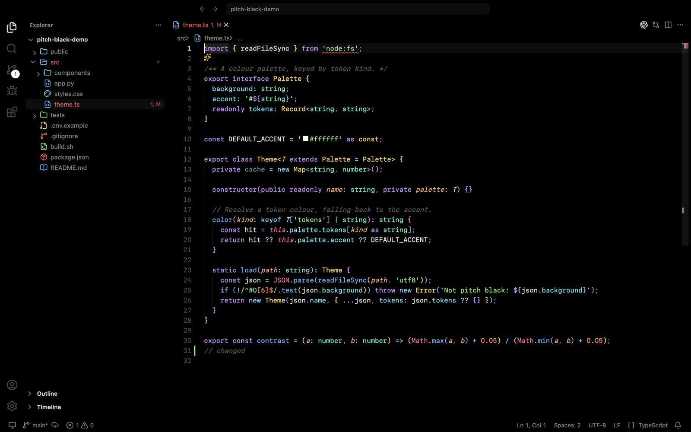
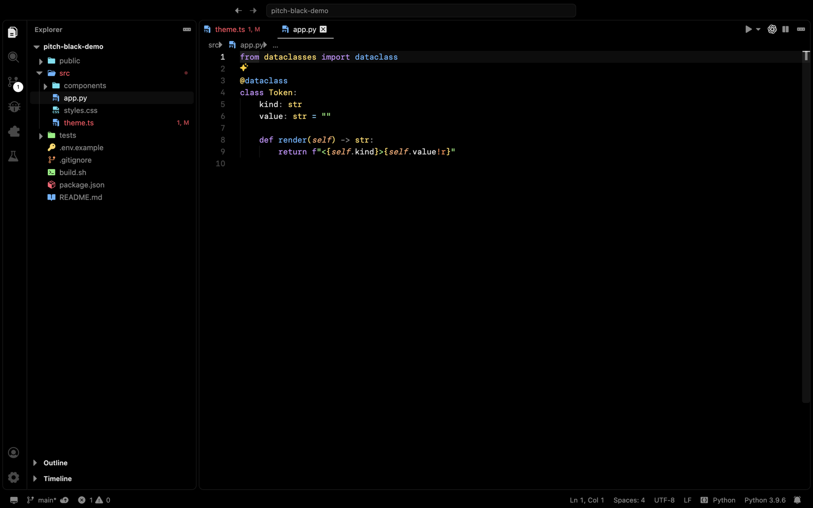

# Pitch Black

**A true-black VS Code theme with vibrant syntax colours and twelve icon libraries for files and the whole interface.**

Every surface is `#000000`: editor, sidebar, tabs, panels, terminal, title bar and status bar. Code comes in bright,
per-language colours that stay readable without turning into a rainbow. Choose from 12 icon sets; when you pick one
for your files, the rest of the interface switches to match.



<p align="center"><sub>Pitch Black Borderless · Lucide file + UI icons · Paper Mono</sub></p>



<p align="center"><sub>Pitch Black · Phosphor Filled file + UI icons</sub></p>

---

## Highlights

- **True black.** `#000000` everywhere, which suits OLED screens and dark rooms, with only faint `#1a1a1a` dividers.
- **Borderless variant.** *Pitch Black Borderless* removes every panel border, focus outline, indicator line and
  shadow, including the card outlines that VS Code 1.14x's newer layout draws, so the window reads as one black surface.
  Popups get a barely-lifted fill instead of an edge.
- **Vibrant, language-aware syntax.** Purple keywords, blue functions, gold types, pink tags and `this`/`self`, cyan
  properties, green strings and orange numbers, with extra rules for HTML/JSX, CSS/SCSS, JSON, YAML/TOML, Python,
  TypeScript, Go, Rust, shell, SQL, Markdown, regex and diffs. Plain variables stay white so it never gets noisy.
- **Twelve icon libraries.** Each comes as a *file icon theme* (colour-coded by file type) and a matching
  *product icon theme* that restyles the activity bar, toolbars, tree arrows, tabs, chat panel and status bar.
- **Icons stay in sync.** Pick a Pitch Black file icon theme and the interface icons follow automatically.
- **Matching terminal palette.** The 16 ANSI colours use the same vivid palette.

## Icon libraries

| Library | Styles | Licence |
| --- | --- | --- |
| [Hugeicons](https://hugeicons.com) (free set) | Stroke | MIT |
| [Phosphor](https://phosphoricons.com) | Outline · Filled | MIT |
| [Lucide](https://lucide.dev) | Outline | ISC |
| [Tabler Icons](https://tabler.io/icons) | Outline · Filled | MIT |
| [Iconoir](https://iconoir.com) | Regular · Solid | MIT |
| [Fluent UI System Icons](https://github.com/microsoft/fluentui-system-icons) | Regular · Filled | MIT |
| [Heroicons](https://heroicons.com) | Outline · Solid | MIT |

That makes **12 file icon themes and 12 product icon themes**, named `Pitch Black <Library> <Style>` and
`Pitch Black <Library> <Style> UI`.

File icons share one mapping: JS yellow, TS blue, Python blue, HTML orange, CSS cyan, JSON amber, YAML pink,
images purple, shell scripts green, `package.json` red, `.env` yellow, lock files dimmed. Well-known folders are tinted
too: `src` blue, `tests` green, `.git` orange, `node_modules` dimmed.

Where a library has no icon for something, the product theme first reuses the closest icon from the same library and
otherwise falls back to VS Code's default. Tabler and Hugeicons cover every interface icon; Heroicons is the smallest
set and covers about three-quarters.

## Install

### From a release `.vsix`

```bash
code --install-extension pitch-black-theme-<version>.vsix
```

Or in VS Code: **Extensions → ⋯ → Install from VSIX…**

### Build from source

```bash
git clone https://github.com/Vyshnav2255/vs-code-themes.git
cd vs-code-themes
npm install
pip install picosvg fonttools      # used to turn SVG icons into icon fonts
npm run build                      # regenerates themes/, fileicons*/ and producticons*/
npx @vscode/vsce package
code --install-extension pitch-black-theme-*.vsix
```

The generated themes and icon sets are committed, so you can also package straight away without building.

## Use it

| What | How |
| --- | --- |
| Colour theme | `Cmd/Ctrl+K Cmd/Ctrl+T` → **Pitch Black** or **Pitch Black Borderless** |
| File icons | Command Palette → **Preferences: File Icon Theme** → `Pitch Black …` |
| Interface icons | Switch automatically with the file icons, or Command Palette → **Preferences: Product Icon Theme** |

Both icon pickers preview live as you arrow through them. Reload the window after installing or updating the
extension (**Developer: Reload Window**).

### Settings

| Setting | Default | Description |
| --- | --- | --- |
| `pitchBlack.syncInterfaceIcons` | `true` | When you pick a Pitch Black file icon theme, also switch the product (interface) icons to the matching `… UI` theme. Set to `false` to mix libraries. |

### Recommended `settings.json`

The theme is designed around [Paper Mono](https://github.com/paper-design/paper-mono), a free monospaced font
(SIL OFL). It isn't bundled; install it from its releases page, then:

```jsonc
{
  "workbench.colorTheme": "Pitch Black Borderless",
  "workbench.iconTheme": "pitch-black-lucide",
  "workbench.productIconTheme": "pitch-black-lucide-ui",
  "editor.fontFamily": "'Paper Mono', Menlo, Monaco, monospace",
  "terminal.integrated.fontFamily": "'Paper Mono', Menlo, Monaco, monospace",
  "editor.minimap.enabled": false
}
```

Paper Mono has no italic, so comments and keywords that the theme sets in italic are rendered slanted.

## Project structure

```
src/
  build.mjs        colour themes (palette, UI colours, token rules) → themes/
  filemap.mjs      shared file-type → icon/colour mapping
  icons.mjs        Hugeicons file + UI themes
  phosphor.mjs     Phosphor (outline, filled)
  lucide.mjs       Lucide
  packs.mjs        Tabler, Iconoir, Fluent, Heroicons
  font.py          SVG icons → product-icon .woff fonts (picosvg + fontTools)
  aliases.mjs      maps newer / variant VS Code icon IDs onto each library
out/extension.js   keeps product icons in sync with the file icon theme
themes/            generated colour themes
fileicons*/        generated file icon themes (coloured SVGs)
producticons*/     generated product icon themes (fonts + definitions)
```

The colour palette lives at the top of [`src/build.mjs`](src/build.mjs). Change it and run `npm run build`.

## Credits and licences

Pitch Black's colour themes and code are an original work, released under the [MIT License](LICENSE).

Icons are generated from these open-source sets and remain under their own licences. The full texts are in
[`THIRD_PARTY_NOTICES.txt`](THIRD_PARTY_NOTICES.txt).

- Hugeicons free icons (`@hugeicons/core-free-icons`): MIT
- Phosphor Icons (`@phosphor-icons/core`): MIT
- Lucide (`lucide-static`): ISC
- Tabler Icons (`@tabler/icons`): MIT
- Iconoir (`iconoir`): MIT
- Fluent UI System Icons (`@fluentui/svg-icons`): MIT
- Heroicons (`heroicons`): MIT
- Recommended font: Paper Mono, SIL Open Font License 1.1 (not bundled)
